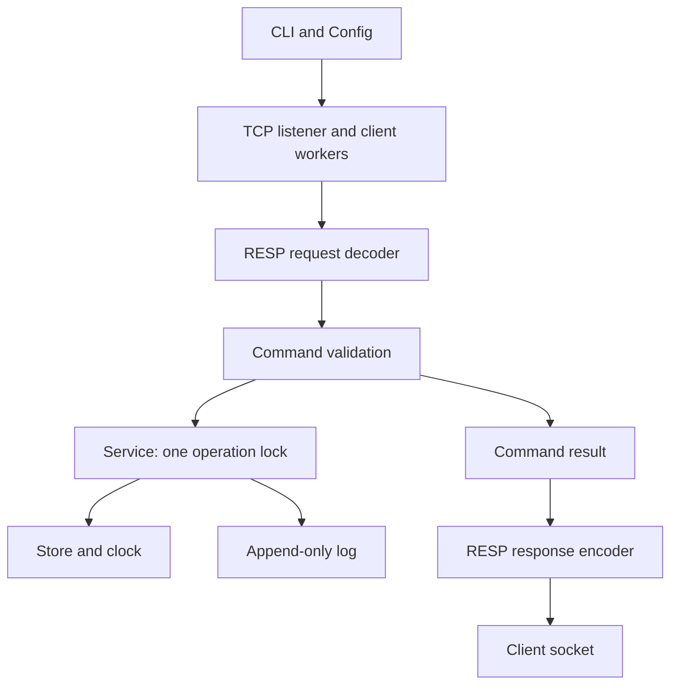

# Version 1 architecture and review

This describes the completed learning implementation, not a production design.
The package version remains `0.1.0`; “version 1” names the scope in PLAN.md, not a
published package release. This focused review is not a security audit or an
exhaustive verification of the largely AI-generated codebase.

## Modules and ownership

| Module | Responsibility |
| --- | --- |
| `__main__.py` | Parse CLI settings, configure logging, install signals, run the server, report failure exit status |
| `config.py` | Immutable validated settings, including supported timeout ranges |
| `server.py` | Listener, per-client buffers/workers, response writes, admission, maintenance scheduling, shutdown |
| `protocol.py` | Parse RESP2 arrays of bulk strings without modifying input; encode command result objects |
| `commands.py` | Validate names/arity/options; dispatch commands; return protocol-independent result objects |
| `service.py` | Own the store; serialize entire keyspace operations and coordinate persistence |
| `store.py` | Ordered byte-key dictionary, entry expiration metadata, lazy removal and rotating cleanup |
| `clock.py` | Monotonic and Unix clock interface; tests supply a fake |
| `persistence.py` | Canonical PUT/DELETE records, flush/fsync, replay, tail repair, write-failure state |
| `metrics.py` | Thread-safe counter increments and snapshots |

Tests live directly in `tests/`, grouped by component. `scripts/demo.py` runs
actual server subprocesses with temporary data; it does not require redis-cli.
The runtime and demo use Python's standard library.

This is a runtime flow, not a literal Python import graph: the codec imports
command result types, and persistence lazily imports the request decoder for
replay. The store imports neither sockets nor the codec.

## Trace a command from bytes to bytes

Consider `SET greeting hello EX 60` with persistence enabled:

1. A client worker receives TCP bytes into its own bytearray. Read boundaries
   have no message significance. The decoder returns either incomplete input,
   a complete tuple with its consumed byte count, or a protocol error.
2. Incomplete input stays buffered. For a complete request, the worker removes
   exactly those bytes and passes the tuple to `CommandProcessor.execute`.
   It repeats this loop for pipelined requests in connection order.
3. The command layer checks SET's arity, the EX option, and the bounded positive
   duration before calling the service. Validation errors become RESP errors
   without mutating the store or closing the connection.
4. `Service.set` acquires its lock. The store prepares an entry with a monotonic
   deadline and a Unix expiration. Nothing is visible in the keyspace yet.
5. The log writes a binary-safe `PUT greeting hello expiration_unix_ms` record,
   flushes its file buffer, and calls `fsync`. Only after successful sync does
   the service install the entry in memory and release the lock.
6. The command layer returns `SimpleString(b"OK")`; the encoder turns that into
   `+OK\r\n`, and the worker writes it outside the service lock.

A GET uses the same pipeline but performs a lazy expiration check under the
service lock, then returns a bulk string or null. INCR validates its integer
value and performs the complete read/modify/write operation under that lock.
Without persistence, mutations apply directly to memory under the same lock.

## Concurrency and lifecycle

The service lock covers reads, writes, TTL changes, cleanup batches, persistence
writes, and log closure. It deliberately serializes disk I/O with keyspace
access. A stalled disk can block reads as well as writes; a slow response reader
does not hold this lock. There is no fairness or throughput guarantee.

A separate client-registry lock protects admission and worker tracking. Workers
start while registered under this lock; shutdown copies the registry and releases
the lock before joining workers. Metrics have their own lock; a snapshot never
acquires the service or registry lock. Snapshot fields are individually accurate
but need not represent one atomic cross-component event.

Startup replays the log before binding the listener. A partial final record is
truncated; an invalid complete record fails startup. Replay applies resulting
mutations rather than rerunning INCR or relative TTL commands. An already-expired
PUT removes any earlier value for its key. Wall time accounts for downtime;
remaining lifetime becomes a new monotonic deadline.

Signal handlers only set a stop flag. The accept loop checks it at most every
100 ms while waiting for connections. One shutdown worker closes the listener
and client sockets, waits for client and cleanup threads, then closes the log.
Operations already inside execution may finish without delivering their reply.
Workers do not deliberately begin another buffered command after noticing stop;
shutdown is not a transaction barrier for commands racing with that request.

The configured grace period bounds the caller's wait. On timeout, embedded
callers receive TimeoutError while non-daemon cleanup continues. The CLI logs a
critical event and forces status 1 exit. It cannot promise graceful completion
of an indefinitely blocked filesystem call. Successful shutdown emits counters
and exits normally. Unexpected expiration-worker failures propagate to the
server caller as an error after cleanup, rather than appearing as a normal stop.

## Core invariant coverage

The numbers below correspond to PLAN.md section 18. These are representative
checks, not an assertion of exhaustive coverage. Test names are discoverable with
`uv run pytest --collect-only -q`.

| # | Invariant | Representative evidence |
| --- | --- | --- |
| 1 | TCP reads do not define requests | `test_fragmented_ping_receives_pong_only_after_complete_resp_request`, `test_pipelined_binary_safe_commands_return_ordered_responses` in `tests/test_server.py` |
| 2 | Incomplete parsing preserves input | `test_every_fragmented_prefix_is_incomplete_without_consuming_bytes` in `tests/test_protocol.py` |
| 3 | Each decoded request executes at most once per worker | `test_concurrent_increments_have_no_lost_updates` checks every returned increment and final count in `tests/test_server.py` |
| 4 | Expired data is never returned | `test_every_operation_hides_expired_keys`, `test_deadline_boundary_and_rounding` in `tests/test_expiration.py` |
| 5 | Validate before mutation | `test_wrong_argument_counts_do_not_mutate` in `tests/test_commands.py`; `test_invalid_expiration_does_not_mutate` in `tests/test_expiration.py` |
| 6 | Failed commands do not partially change visible state | `test_disk_failure_preserves_memory_and_disables_writes` in `tests/test_persistence.py`; `test_incr_errors_preserve_value` in `tests/test_commands.py` |
| 7 | Operations are atomic to other clients | `test_increment_holds_lock_between_read_and_write` in `tests/test_service.py`; concurrent TCP increments |
| 8 | Persistence order matches mutation order | `test_concurrent_acknowledged_increments_survive_restart`, `test_memory_is_only_changed_after_sync` in `tests/test_persistence.py` |
| 9 | Socket I/O is outside the service lock | `test_blocked_response_write_does_not_hold_service_lock` in `tests/test_server.py` |
| 10 | Client failures are isolated | `test_protocol_error_closes_only_the_malformed_connection` in `tests/test_server.py` |
| 11 | Store works independently of sockets/RESP | Direct Store tests in `tests/test_store.py` and `tests/test_expiration.py`; import boundary reviewed above |
| 12 | TTL tests control time | FakeClock fixture in `tests/conftest.py`, used in expiration and replay tests; only the manual demo waits for real TTL |
| 13 | Shutdown has a bounded grace/failure path | Signal, active-write, and permanently-blocked-disk tests in `tests/test_operations.py` |
| 14 | Normal logs omit values/secrets | `test_counters_and_logs_cover_errors_expiration_and_persistence` in `tests/test_operations.py` |

The at-most-once property is per decoded request on one connection. It does not
provide exactly-once behavior for client retries after a disconnect. Failed
persistence may leave a replayable record despite unchanged current memory.

## Final review findings and scope

The milestone 8 review inspected source boundaries, command validation, parser
buffer ownership, lock ordering, expiration, persistence failure handling, and
shutdown, then mapped the core invariants to the existing tests. It found and
fixed two operational issues, each with a regression test:

- Huge positive timeout values passed validation but could overflow socket or
  threading APIs. Configuration now bounds durations to the platform-supported
  range and bounds the socket backlog; even extremely large Python integers
  are rejected before numeric conversion.
- An unexpected cleanup exception was logged but could produce a successful
  server exit. The exception now propagates after coordinated cleanup.

Known deferred work is explicit in the README: security, stronger durability
formats, compaction, global memory limits, performance work, broader platform
validation, and the optional post-version-1 features. No new feature milestone
is required for the scoped learning implementation. Passing the suite and demo
is evidence for these exercised behaviors, not a production-readiness claim.

Validation at milestone completion: 172 pytest cases passed; Ruff lint and
format checks and `git diff --check` passed. The self-contained demo completed
both server lifecycles, checked all responses, and removed its temporary data.
These checks ran locally on macOS with Python 3.12, not a platform test matrix.
